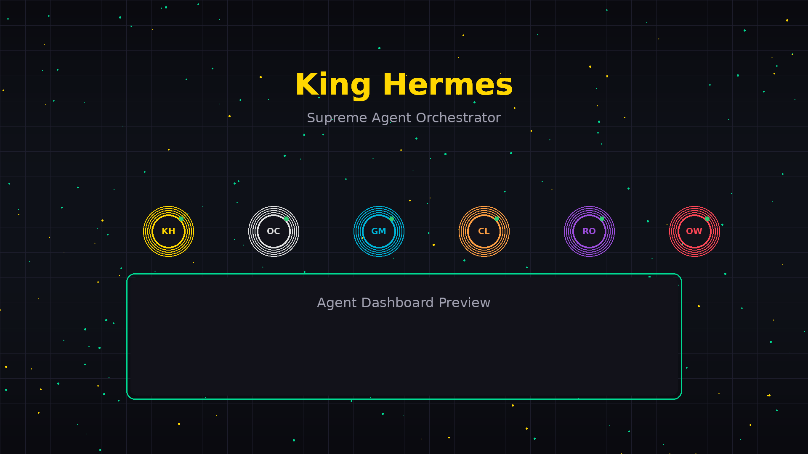
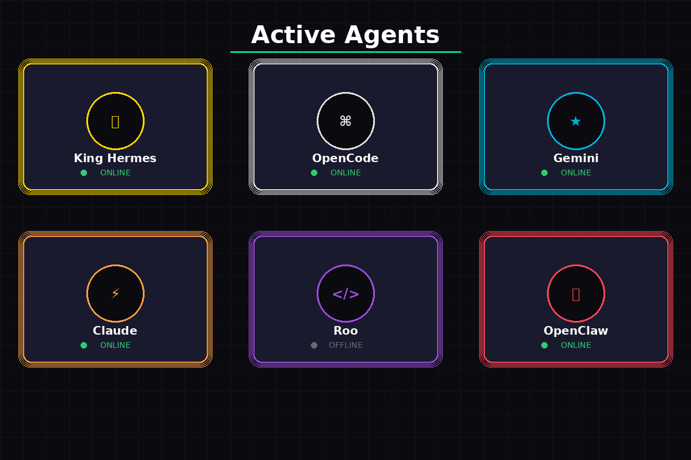
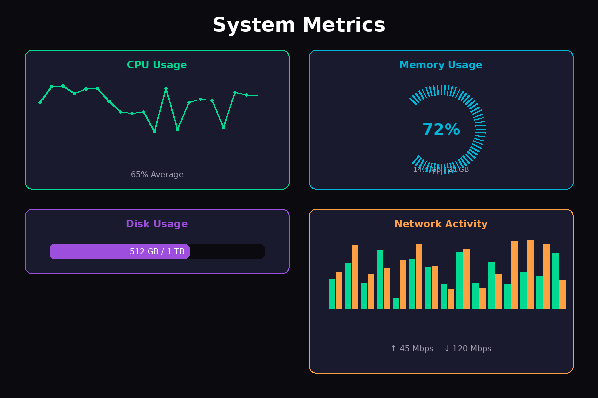
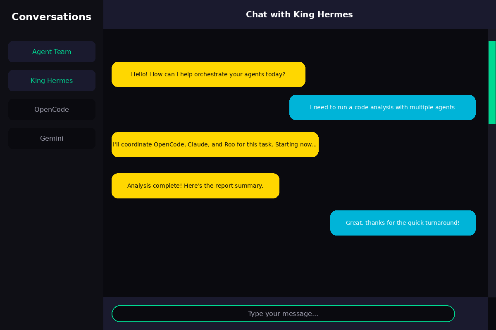
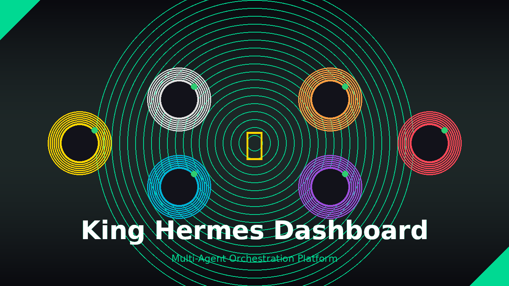

# 👑 King Hermes Dashboard

[](https://vercel.com/new/clone?repository-url=https://github.com/Maliot100X/king-hermes-dashboard)
[](LICENSE)
[](https://king-hermes-dashboard.vercel.app)

**Supreme Multi-Agent Orchestration Platform** — A production-grade real-time dashboard for monitoring and commanding AI agent swarms.



## 🚀 Features

### Real-Time Multi-Agent Monitoring
- **6 Specialized Agents**: King Hermes, OpenCode, Gemini, Claude, Roo, OpenClaw
- **Live Status Tracking**: CPU, Memory, Disk, Uptime for each agent
- **WebSocket Integration**: Real-time bi-directional communication
- **Agent Command Interface**: Direct command input for each agent

### Interactive Dashboard
- **6 Functional Tabs**: Agents, System, Tasks, Chat, Logs, Settings
- **3D Visualization**: Three.js background with particle effects
- **GSAP Animations**: Smooth transitions and micro-interactions
- **Responsive Design**: Works on desktop, tablet, and mobile

### System Monitoring
- **Real-time Metrics**: CPU usage, Memory consumption, Disk I/O
- **Live Charts**: Animated data visualization with Recharts
- **Connection Status**: WebSocket health monitoring
- **Log Streaming**: Real-time system logs



## 🛠️ Tech Stack

| Technology | Purpose |
|------------|---------|
| **Next.js 16** | React framework with App Router |
| **React 19** | UI component library |
| **TypeScript 5** | Type-safe development |
| **Three.js** | 3D background visualization |
| **GSAP** | Advanced animations |
| **Tailwind CSS v4** | Utility-first styling |
| **WebSocket (ws)** | Real-time communication |
| **Recharts** | Data visualization |

## 📸 Preview

### System Metrics View


### Chat Interface


### YouTube Thumbnail


## 🚀 Quick Start

### Prerequisites
- Node.js 18+ 
- npm or yarn

### Installation

```bash
# Clone the repository
git clone https://github.com/Maliot100X/king-hermes-dashboard.git
cd king-hermes-dashboard/dashboard

# Install dependencies
npm install

# Start the WebSocket server
npm run server

# In a new terminal, start the dashboard
npm run dev
```

### Environment Variables

Create `.env.local`:

```bash
NEXT_PUBLIC_WS_URL=ws://localhost:8080
NEXT_PUBLIC_DASHBOARD_URL=http://localhost:3000
WS_HOST=0.0.0.0
WS_PORT=8080
```

## 🌐 Deployment

### Vercel (Recommended)

[](https://vercel.com/new/clone?repository-url=https://github.com/Maliot100X/king-hermes-dashboard)

1. Click the button above
2. Select your GitHub repository
3. Add environment variables
4. Deploy instantly

### Manual Deployment

```bash
# Build for production
npm run build

# Start production server
npm run start
```

## 🏗️ Architecture

```
King Hermes Dashboard
├── Next.js 16 App Router
├── WebSocket Server (port 8080)
├── Three.js 3D Scene
├── Agent Cards (6 agents)
├── Real-time Metrics
└── Chat Interface
```

### WebSocket Communication
- **Port**: 8080
- **Protocol**: ws:// (or wss:// for production)
- **Message Types**: `metrics`, `agent_status`, `chat`, `task`, `log`

## 🎨 Design System

### Colors
- **Background**: `#0a0a0f` (Abyss)
- **Card**: `#12121a` (Carbon)
- **Border**: `#2a2a35` (Charcoal)
- **Accent**: `#00d992` (Emerald)
- **Text Primary**: `#ffffff` (Snow)
- **Text Secondary**: `#a0a0b0` (Slate)

### Agent Colors
| Agent | Color |
|-------|-------|
| King Hermes | `#FFD700` (Gold) |
| OpenCode | `#fdfcfc` (White) |
| Gemini | `#4285F4` (Blue) |
| Claude | `#c96442` (Orange) |
| Roo | `#9B59B6` (Purple) |
| OpenClaw | `#FF6B35` (Red-Orange) |

## 📊 Agent Capabilities

### King Hermes (Supreme Orchestrator)
- Multi-agent coordination
- Task delegation
- System monitoring
- Emergency protocols

### OpenCode (AI Coding Agent)
- Code generation
- Repository analysis
- Bug fixing
- Feature implementation

### Gemini (Google AI)
- Research and analysis
- Documentation
- Best practices
- Code review

### Claude (Anthropic AI)
- Complex reasoning
- Architecture design
- System planning
- Quality assurance

### Roo (Roo Code)
- Code editing
- Refactoring
- File operations
- Terminal commands

### OpenClaw (Claw Agent)
- Process management
- System operations
- Automation
- Monitoring

## 🔧 Development

### Scripts

```bash
npm run dev          # Start development server
npm run build        # Build for production
npm run start        # Start production server
npm run server       # Start WebSocket server
npm run lint         # Run ESLint
```

### Project Structure

```
dashboard/
├── app/
│   ├── components/
│   │   ├── Scene3D.tsx        # Three.js background
│   │   ├── AgentCard.tsx      # Agent status card
│   │   └── Tabs/              # All 6 tabs
│   ├── hooks/
│   │   └── useWebSocket.ts    # WebSocket hook
│   ├── page.tsx               # Main dashboard
│   └── layout.tsx             # Root layout
├── server/
│   └── websocket-server.js    # WebSocket server
├── public/
│   └── images/                # Screenshots & assets
└── package.json
```

## 🤝 Connect

- **Telegram**: [@KiloClawAi](https://t.me/KiloClawAi)
- **Kaggle**: [Maliot100X](https://www.kaggle.com/Maliot100X)
- **GitHub**: [Maliot100X](https://github.com/Maliot100X)

## 📜 License

MIT License - see [LICENSE](LICENSE) file

## 🙏 Credits

Built with ❤️ by **Solxhunter X100** (King Hermes)

Powered by:
- Next.js Team
- Three.js Community
- Tailwind CSS
- Vercel

---

**King Hermes Dashboard** — *Command Your AI Army*
